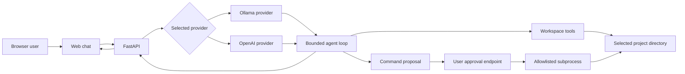

# Architecture

## Components

- `main.py` exposes FastAPI chat, model/settings, workspace, and command approval APIs
  and serves the static browser client.
- `agent.py` owns the bounded model/tool loop. It accepts a provider interface and a
  selected workspace; tools are explicitly dispatched rather than exposing Python or
  a general shell.
- `providers/` implements the common asynchronous `complete(messages, model)` protocol
  for Ollama's chat API and the official OpenAI Python SDK.
- `workspace.py` enforces a resolved workspace root, ignore/exclusion rules, size
  limits, safe file operations, and explicit deletion confirmation.
- `terminal.py` validates an allowlisted command proposal, stores a one-use approval,
  then executes an argument vector with `shell=False`, timeout, and workspace cwd.
- `web/` is a dependency-free HTML/CSS/JavaScript client. It keeps conversation history
  in the current browser tab.

## Request flow

## Agent loop and tools

The server prepends a fixed system instruction and sends the conversation to exactly
the selected provider and model. A plain-text answer ends the turn. A response matching
the JSON tool-call shape dispatches one of five tools: list, read, search, write, or
propose a command. Tool results are appended as data, then sent to the same provider.
The loop has a configurable maximum number of iterations (`AGENT_MAX_ITERATIONS`, 5 by
default); at the limit it returns an explicit status. File writes are emitted as
diff-backed proposals and are committed only after the user approves them; the server
reads the file back and reports verification. Command proposals are not executed in
the agent loop.

## Provider interchangeability

Providers implement the same protocol and receive identical role/content messages and
the chosen model identifier. Provider selection is resolved for each request; the
orchestrator does not contain vendor-specific branching. OpenAI credentials are only
used by its server-side adapter. Local-only operation requires no OpenAI key.
